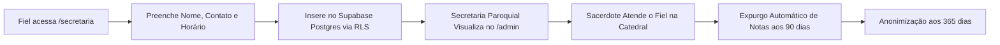

# Relatório de Impacto à Proteção de Dados (RIPD) — Atendimentos Pastorais e Confissões

**Documento**: RIPD-01 (Atividade `A001 — pastoral-appointments`)  
**Controlador**: Paróquia Sagrado Coração de Jesus — Catedral de Colatina (Mitra Diocesana)  
**Marco Legal**: Artigos 11, II, "d" e 38 da Lei nº 13.709/2018 (LGPD) c/c Resolução CD/ANPD nº 2/2022 (Art. 4º)  
**Data da Avaliação**: 23/10/2026  
**Versão**: 1.0  
**Metodologia de Análise de Risco**: ISO 31000 / ISO 27005  

---

## 1. Identificação e Contexto da Atividade

* **Nome da Atividade**: Agendamento de Confissões, Direção Espiritual e Atendimentos Pastorais.
* **Objetivo Pastoral**: Proporcionar aos fiéis canal seguro e acessível para solicitação de atendimento com o clero (padres e vigários), organizando a disponibilidade de horários sem expor os motivos espirituais ou gerar constrangimento ao fiel.
* **Dados Pessoais Envolvidos**: Nome, telefone, e-mail opcional, tipo de atendimento (`confissao`, `direcao_espiritual`, `pastoral_escuta`), comunidade e notas descritivas.
* **Por que é Alto Risco?**: Trata **dados pessoais sensíveis (Art. 11)** relativos à convicção religiosa e foro íntimo de consciência em escala paroquial.

---

## 2. Descrição do Ciclo de Tratamento

---

## 3. Matriz de Avaliação de Riscos (Metodologia ISO 31000)

| ID | Risco Identificado | Probabilidade (1-5) | Impacto (1-5) | Nível (P×I) | Medidas e Salvaguardas Adotadas | Risco Residual |
| :---: | :--- | :---: | :---: | :---: | :--- | :---: |
| **R01** | Vazamento de notas confidenciais de confissão no banco | 2 | 5 | **10 (Alto)** | Criptografia em repouso AES-256 no Supabase, políticas RLS ativas para usuários autenticados e expurgo automático das notas aos 90 dias. | **Baixo** ✅ |
| **R02** | Exposição de nomes de fiéis na consulta pública de horários ocupados | 1 | 4 | **4 (Médio)** | Criação de função RPC segura `get_booked_appointment_slots` com `SECURITY DEFINER` que retorna apenas horas e minutos ocupados, sem expor PII. | **Nulo** ✅ |
| **R03** | Interceptação em trânsito de dados de agendamento | 1 | 5 | **5 (Médio)** | Conexão estrita TLS 1.3 / HTTPS forçada na Vercel e API Supabase. | **Baixo** ✅ |
| **R04** | Acesso indevido por operadores ou secretários desautorizados | 2 | 4 | **8 (Médio)** | Autenticação com controle de acesso baseado em papéis (RBAC) e termo de confidencialidade da equipe eclesial. | **Baixo** ✅ |

---

## 4. Teste de Proporcionalidade e Minimização (Art. 6º, III)

* **O tratamento é indispensável?**: Sim. O agendamento é indispensável para organizar os horários dos 4 sacerdotes da catedral sem filas de espera humilhantes.
* **Há excesso de dados?**: Foram implementadas diretrizes para que o campo de notas seja estritamente opcional, orientando o fiel a compartilhar detalhes íntimos apenas presencialmente com o sacerdote.
* **Salvaguardas Especiais**: Expurgo automático das anotações pastorais após 90 dias do atendimento.

---

## 5. Parecer e Decisão do Encarregado (DPO)

* [x] **Aprovado com a implementação das salvaguardas**: As medidas técnicas de segurança (RLS, TLS 1.3, RPC sem PII e rotina de sanitização aos 90 dias) reduzem o risco residual a patamares estritamente aceitáveis e compatíveis com a missão pastoral da Igreja.
* [ ] Rejeitado.

**Encarregado de Proteção de Dados (DPO)**: Setor de Governança de Dados da Catedral  
**Data**: 23/10/2026  
