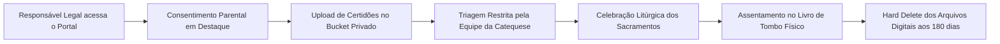

# Relatório de Impacto à Proteção de Dados (RIPD) — Inscrições Sacramentais e Catequese Infantil

**Documento**: RIPD-02 (Atividade `A002 — sacramental-registrations`)  
**Controlador**: Paróquia Sagrado Coração de Jesus — Catedral de Colatina (Mitra Diocesana)  
**Marco Legal**: Artigos 14 e 38 da Lei nº 13.709/2018 (LGPD) c/c Lei nº 15.211/2025 (ECA Digital)  
**Data da Avaliação**: 23/10/2026  
**Versão**: 1.0  
**Metodologia de Análise de Risco**: ISO 31000 / ISO 27005  

---

## 1. Identificação e Contexto da Atividade

* **Nome da Atividade**: Inscrições para Iniciação Cristã (Batismo, Primeira Eucaristia e Crisma).
* **Objetivo Pastoral**: Acolher as famílias da comunidade paroquial e organizar as turmas de catequese preparatórias para a recepção dos sacramentos da Igreja Católica.
* **Titulares Protegidos**: **Crianças (até 12 anos incompletos) e adolescentes (entre 12 e 18 anos)** e seus respectivos pais/mães ou responsáveis legais.
* **Dados Pessoais Envolvidos**: Nome da criança, data de nascimento, filiação, dados dos padrinhos, contato do responsável e imagens digitalizadas de certidões de nascimento anexadas.
* **Por que é Alto Risco?**: Tratamento intensivo de **dados de crianças e adolescentes**, somado à guarda de documentos civis digitalizados e dados sensíveis de convicção religiosa.

---

## 2. Descrição do Ciclo de Tratamento

---

## 3. Matriz de Avaliação de Riscos (Metodologia ISO 31000)

| ID | Risco Identificado | Probabilidade (1-5) | Impacto (1-5) | Nível (P×I) | Medidas e Salvaguardas Adotadas | Risco Residual |
| :---: | :--- | :---: | :---: | :---: | :--- | :---: |
| **R01** | Acesso público acidental a certidões de nascimento no Storage | 2 | 5 | **10 (Alto)** | Bucket configurado como estritamente **privado**, com URLs assinadas temporárias e acesso exclusivo autenticado por RLS. | **Baixo** ✅ |
| **R02** | Cadastro não autorizado de menor sem ciência dos pais | 2 | 4 | **8 (Médio)** | Obrigatoriedade de preenchimento dos dados do responsável e confirmação de guarda sob as penas da lei (Art. 14 LGPD). | **Baixo** ✅ |
| **R03** | Perfilamento ou uso comercial de dados de catequizandos | 1 | 5 | **5 (Médio)** | Proibição sistêmica absoluta e ausência de scripts de rastreamento publicitário (ECA Digital — Lei 15.211/2025). | **Nulo** ✅ |
| **R04** | Acúmulo perene de documentos infantis na nuvem | 2 | 4 | **8 (Médio)** | Política de descarte automático (*Hard Delete*) das certidões digitalizadas após 180 dias da celebração do sacramento. | **Baixo** ✅ |

---

## 4. Teste de Necessidade e Melhor Interesse da Criança (Art. 14 LGPD)

* **Melhor Interesse do Menor**: O tratamento dos dados atende primordialmente ao desenvolvimento integral, moral e espiritual da criança no seio de sua comunidade religiosa, com a plena ciência e solicitação de seus genitores.
* **Minimização**: Não se exige número de CPF da criança no momento da pré-inscrição web, coletando-se apenas os dados canonicamente necessários para a emissão da certidão sacramental eclesiástica.
* **Descarte Seguro**: A paróquia não retém cópias digitais indefinidas de certidões civis na nuvem após a lavratura do termo litúrgico no livro paroquial.

---

## 5. Parecer e Decisão do Encarregado (DPO)

* [x] **Aprovado com as salvaguardas implementadas**: O processo atende integralmente ao Artigo 14 da LGPD e à nova Lei nº 15.211/2025 (ECA Digital), conferindo segurança jurídica às famílias e à instituição eclesial.
* [ ] Rejeitado.

**Encarregado de Proteção de Dados (DPO)**: Setor de Governança de Dados da Catedral  
**Data**: 23/10/2026  
