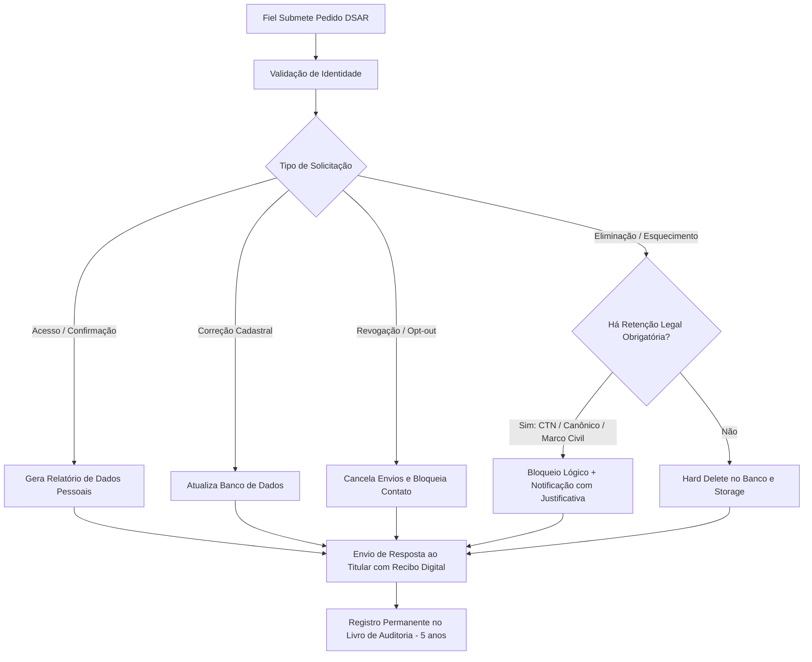

# Workflow de Atendimento aos Direitos do Titular (DSAR — Art. 18 LGPD)

**Projeto**: Ecclesiam App (Paróquia Piloto: Catedral de Colatina)  
**Marco Legal**: Artigos 18, 19 e 20 da Lei nº 13.709/2018 (LGPD) e Resolução CD/ANPD nº 2/2022 (ATPP)  
**SLA Legal Máximo**: **15 dias corridos** (Art. 19, II da LGPD) ou **30 dias corridos** para Agentes de Tratamento de Pequeno Porte / Entidades Religiosas (Art. 14 da Res. ANPD nº 2/2022)  

---

## 🧭 1. Os 9 Direitos do Fiel Titular de Dados (Art. 18 da LGPD)

| # | Direito Garantido pela LGPD | Canal no Ecclesiam App | Prazo de Resposta | Responsável Interno |
| :---: | :--- | :--- | :---: | :--- |
| **I** | **Confirmação de Tratamento** | Formulário `/privacidade` ou e-mail DPO | Imediato (simplificado) | Secretaria Paroquial |
| **II** | **Acesso aos Dados** | Exportação eletrônica estruturada | Até 15 dias corridos | Encarregado (DPO) |
| **III** | **Correção de Dados Incompletos / Inexatos** | Secretaria On-line ou formulário DSAR | Até 5 dias úteis | Secretaria Paroquial |
| **IV** | **Anonimização, Bloqueio ou Eliminação** | Formulário de requerimento formal | Até 15 dias corridos | Encarregado & TI |
| **V** | **Portabilidade dos Dados** | Exportação de dados cadastrais (JSON/CSV) | Até 15 dias corridos | TI / Administrador |
| **VI** | **Eliminação dos Dados Tratados com Consentimento** | Canal DSAR (`/api/dsar/erasure`) | Até 15 dias corridos | TI / Administrador |
| **VII** | **Informação sobre Compartilhamento com Terceiros** | Política de Privacidade pública | Imediato | Disponível no portal |
| **VIII** | **Informação sobre a Possibilidade de Não Consentir** | Telas de cadastro e termos da catequese | Imediato | No ato da inscrição |
| **IX** | **Revogação do Consentimento** | Descadastramento via link ou e-mail | Imediato / até 48h | Secretaria Paroquial |

---

## 🔄 2. Fluxo Operacional de Atendimento Passo a Passo

---

## 🔒 3. Validação Segura de Identidade do Solicitante

Para evitar vazamento acidental de dados para terceiros ou fraudadores:
1. **Titular Autenticado no Sistema**: A sessão autenticada é suficiente.
2. **Titular Não-Autenticado (Paroquiano Geral)**:
   * O solicitante informa Nome Completo, E-mail e Telefone cadastrados.
   * O sistema dispara um **código de verificação OTP (One-Time Password)** de 6 dígitos via e-mail ou SMS.
   * **Proibição Mandatória (Art. 6º, III)**: A paróquia não pode exigir o envio de novas fotos de documentos com selfie apenas para confirmar o pedido de dados, salvo fundada suspeita de fraude grave.

---

## ⚖️ 4. Conflito entre Eliminação (Art. 18, VI) e Direito Canônico / Fiscal

Quando o fiel solicita: *"Quero que apaguem todo meu histórico da igreja"*:
1. **O que É eliminado de imediato**:
   * Telefone, e-mail, notas pastorais de confissão e atendimento espiritual.
   * Documentos digitalizados no Storage (certidões, fotos).
   * Desativação completa do cadastro de dizimista e interrupção de contatos.
2. **O que NÃO pode ser eliminado (Fundamento Art. 16, I da LGPD)**:
   * **Livro de Batizados e Casamentos (Direito Canônico)**: Os registros solenes de sacramentos canônicos possuem natureza histórica indelével e pública da Igreja Católica, não sendo passíveis de anulação cadastral civil retrospectiva.
   * **Registros Contábeis de Doações (< 5 anos)**: Obrigatoriedade fiscal de prestação de contas aos órgãos fazendários (CTN Art. 174).
3. **Comunicação Transparente**: O DPO responde formalmente ao fiel elucidando os dados eliminados e justificando a conservação restrita e bloqueada dos registros históricos e fiscais.
