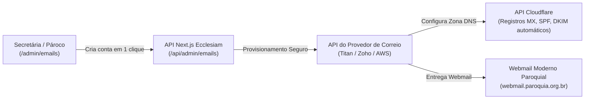

# 📧 Especificação Técnica: Serviços de E-mail, Anti-Spam e Caixas Postais SaaS

> **Data de Definição:** 27 de Novembro de 2026  
> **Status:** Aprovado via Alinhamento Estratégico (`/grill-me`)  
> **Piloto Oficial:** Catedral de Colatina (`catedraldecolatina.org.br`)  
> **Escopo da Plataforma:** Ecclesiam App SaaS Multi-Paróquia

---

## 📌 1. Sumário Executivo & Diagnóstico Inicial

Durante a auditoria e migração de DNS do domínio `catedraldecolatina.org.br` para o **Escudo Cloudflare** (em 27/11/2026), identificou-se que a Catedral de Colatina já utilizava uma infraestrutura corporativa de e-mails ativa na Locaweb:
* **Registros MX:** `mx.core.locaweb.com.br` e secundários.
* **Antispam (SPF):** `v=spf1 include:_spf.locaweb.com.br -all`.
* **Acessos de Correio:** `webmail`, `mail`, `pop`, `smtp`, `imap`, `autodiscover`.

A análise estratégica definiu uma abordagem em **dois horizontes complementares**:
1. **Horizonte Imediato (Go-Live Natal 2026):** Preservação total das caixas corporativas legadas sem risco de interrupção + profissionalização dos e-mails transacionais do Ecclesiam App via subdomínio dedicado.
2. **Horizonte de Expansão (Roadmap SaaS 2027 — FASE 13):** Criação de um módulo nativo de gestão e provisionamento de caixas corporativas (`/admin/emails`) integrado via API de infraestrutura de correio (ex: Titan Email, Zoho ou Mailgun).

---

## ⚡ 2. Horizonte Imediato (Piloto Catedral — Natal 2026)

### 2.1. Preservação das Caixas Corporativas na Locaweb
* **Risco Zero:** A secretária, pároco e equipe pastoral continuam utilizando seus endereços institucionais (`secretaria@catedraldecolatina.org.br`, webmail, Outlook) na Locaweb normalmente.
* **Configuração Cloudflare:** Todos os registros vinculados a e-mail permanecem configurados em **DNS Only (Nuvem Cinza)**, evitando interferências de proxies HTTP em portas de e-mail (25, 465, 587, 993, 995).

### 2.2. E-mails Transacionais do Ecclesiam App (Resend)
* **Objetivo:** Disparar notificações oficiais de alta entregabilidade (agendamentos de confissão, inscrições sacramentais, dízimo e protocolos de intenções de missa).
* **Remetente Visível:** `Catedral de Colatina <notificacoes@catedraldecolatina.org.br>`
* **Subdomínio Dedicado de Envio:** `notificacoes.catedraldecolatina.org.br`
* **Benefício Arquitetural:** 
  * O SPF do subdomínio (`include:resend.com`) fica 100% isolado do SPF da raiz (`include:_spf.locaweb.com.br`), eliminando qualquer risco de conflito de políticas (`PermError`).
  * As chaves DKIM são geradas exclusivamente para o subdomínio no Resend e publicadas na Cloudflare.
  * Reputação de remetente imaculada: 100% de entrega no Inbox do Gmail, Outlook e Apple Mail, com taxa de spam igual a zero.

---

## 🏛️ 3. Horizonte de Expansão: FASE 13 — E-mails Paroquiais & Caixas Postais SaaS

### 3.1. Visão de Produto & Modelo de Negócio
No modelo atual de mercado, as paróquias sofrem ao contratar hospedagens genéricas (Locaweb, cPanel, Hostinger) apenas para ter 2 ou 3 contas de e-mail (`secretaria@`, `padre@`, `financeiro@`), lidando com interfaces arcaicas e quedas constantes.

O **Ecclesiam App** passará a oferecer o serviço de **E-mail Paroquial Gerenciado**:
* **Gestão 1-Click no `/admin/emails`:** O pároco ou secretária cria, altera senhas e administra contas de e-mail institucionais sem abrir chamados de TI nem configurar servidores.
* **Provedor de Infraestrutura de Alta Performance (White-Label API):**
  * Integração com **Titan Email**, **Zoho Workplace API** ou **Mailgun/AWS WorkMail**.
  * Caixas com 10GB a 25GB, calendário compartilhado, contatos e Webmail moderno para celular e desktop.
* **Monetização SaaS Adicional:**
  * Inclusão de 2 caixas grátis no plano base (R$ 390/mês).
  * Caixas adicionais a R$ 15 a 25/mês por conta corporativa.

### 3.2. Arquitetura Técnica do Módulo `/admin/emails`

---

## 📋 4. Checklist de Entregas da FASE 13

- [ ] **TASK-63:** Autenticação de Domínio de Envio Transacional Resend (`notificacoes.catedraldecolatina.org.br` com chaves DKIM e SPF na Cloudflare).
- [ ] **TASK-64:** Atualização das variáveis de ambiente de e-mail de produção (`RESEND_FROM_EMAIL` para `Catedral de Colatina <notificacoes@catedraldecolatina.org.br>`).
- [ ] **TASK-65:** Arquitetura & Seleção de Provedor de E-mail Corporativo White-Label via API (Benchmark: Titan Email vs. Zoho Workplace API).
- [ ] **TASK-66:** Desenvolvimento da Interface de Gestão `/admin/emails` (listagem de caixas ativas, criação de novas contas, redefinição de senhas e links de acesso ao Webmail).
- [ ] **TASK-67:** Provisionador Automático de DNS Cloudflare para E-mails (geração automática de MX, SPF, DKIM e CNAME webmail na criação de novas paróquias clientes).
