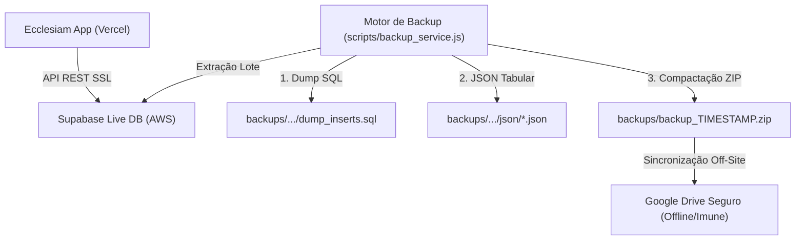

# 📖 Manual Operacional de Recuperação de Desastres (Disaster Recovery)
## Ecclesiam App — Protocolo de Segurança e Contingência

> **Documento Oficial de Continuidade de Negócio e Recuperação (M-One Standard)**  
> **Data:** 24 de Novembro de 2026  
> **Escopo:** Catedral do Sagrado Coração de Jesus e Plataforma SaaS Multi-Paróquia

---

### 1. Visão Geral da Arquitetura de Contingência

Em conformidade com os mais altos padrões de segurança e DevSecOps, o **Ecclesiam App** adota um sistema de contingência desacoplado da infraestrutura do provedor de nuvem:



Mesmo se o projeto no Supabase sofrer invasão, exclusão acidental ou interrupção de serviço, os dados completos da paróquia e fiéis permanecem **preservados off-site no Google Drive e em disco local**.

---

### 2. Como Rodar o Backup Manual Imediato

Para gerar uma cópia de segurança completa com timestamp a qualquer momento:

```bash
# Na raiz do projeto ecclesiam-app:
node scripts/backup_service.js
```

**O que o script faz automaticamente:**
1. Conecta-se à API protegida do Supabase.
2. Extrai os dados das **33 tabelas públicas**.
3. Gera arquivos JSON individuais por tabela (para auditoria humana instantânea).
4. Gera um arquivo `dump_inserts.sql` com instruções `INSERT INTO ... ON CONFLICT DO NOTHING`.
5. Compacta tudo em um arquivo `.zip` com timestamp.
6. Copia o `.zip` diretamente para:  
   `G:\Meu Drive\TRABALHOS\01 - NEGÓCIOS E PROJETOS ATIVOS\ECCLESIAN APP\BACKUPS\`

---

### 3. Como Restaurar os Dados em Caso de Ataque ou Perda (Disaster Recovery)

Se o banco de dados for corrompido ou sofrer ataque de bot:

#### Cenário A: Restauração Automática em Lotes (Mais Rápida — ~2 minutos)
Execute o script de recuperação emergencial, que processa a inserção em blocos de 200 registros:

```bash
# Restaura o backup mais recente automaticamente:
node scripts/emergency_restore.js

# Ou especifique uma pasta de backup específica:
node scripts/emergency_restore.js backups/backup_2026-11-24T22-15-00
```

#### Cenário B: Restauração Manual via SQL (Painel Supabase ou psql)
1. Abra o arquivo `backups/backup_TIMESTAMP/dump_inserts.sql`.
2. Copie o conteúdo ou execute via SQL Editor do Supabase.
3. Como todas as instruções usam `ON CONFLICT DO NOTHING`, os registros são inseridos com segurança sem duplicar chaves primárias.

---

### 4. Monitoramento Ativo de Saúde (`/api/healthz`)

O sistema disponibiliza um endpoint leve de monitoramento:
* **URL:** `https://seu-dominio.com.br/api/healthz` (ou `http://localhost:3000/api/healthz`)
* **Retorno HTTP 200:**
  ```json
  {
    "status": "healthy",
    "database": "connected",
    "latencyMs": 42,
    "uptime": "1200s",
    "checks": {
      "supabaseRest": "ok",
      "schemaPublic": "reachable"
    }
  }
  ```
* Se o banco cair ou sofrer latência anormal, o endpoint retorna HTTP 500/503 alertando seu uptime monitor (UptimeRobot, BetterStack, etc.).

---

### 5. Recomendações de Hardening no Provedor Supabase

1. **Ativação de 2FA (Autenticação em Dois Fatores):** Obrigatório na conta do desenvolvedor/proprietário do Supabase.
2. **Network Restrictions (Restrição de IPs na Porta 5432):** No console Supabase (`Database` ➔ `Network Restrictions`), se a sua aplicação só se comunica via REST API, bloqueie o acesso direto à porta 5432 de IPs desconhecidos da internet.
3. **Rotação Anual de Chaves de API:** Rotacionar o JWT secret e chaves no console Supabase antes do lançamento comercial de novas paróquias.
