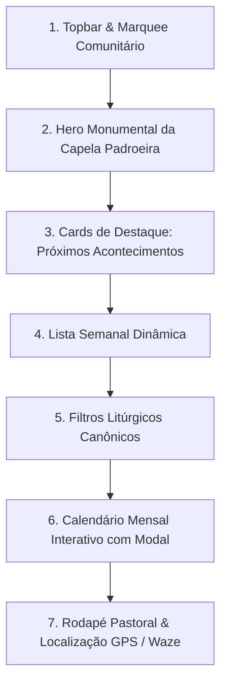

# 🏛️ Modelo Canônico de Landing Page para as CEBs (Comunidades Eclesiais de Base)

> **Status:** Homologado como Diretriz Arquitetural e de Produto  
> **Referência Oficial:** [`app/agenda-liturgica/page.tsx`](file:///c:/Users/Start/ecclesiam-app/app/agenda-liturgica/page.tsx)  
> **Componentes Centrais:** [`LiturgicalScheduleView.tsx`](file:///c:/Users/Start/ecclesiam-app/components/horarios/LiturgicalScheduleView.tsx), [`LiturgicalMonthlyCalendar.tsx`](file:///c:/Users/Start/ecclesiam-app/components/horarios/LiturgicalMonthlyCalendar.tsx) e [`CelebrationDetailsModal.tsx`](file:///c:/Users/Start/ecclesiam-app/components/horarios/CelebrationDetailsModal.tsx)  
> **Data de Homologação:** Outubro de 2026

---

## 1. Visão Geral & Decisão Arquitetural

A estrutura concebida para a página **Agenda Litúrgica da Catedral** (`/agenda-liturgica`) foi estabelecida formalmente como o **modelo padrão (blueprint)** para as Landing Pages públicas individuais de cada uma das **12 Comunidades Eclesiais de Base (CEBs)** da Paróquia Sagrado Coração de Jesus (`/comunidades/[slug]`).

Cada comunidade (ex.: *Nossa Senhora Aparecida*, *São Judas Tadeu*, *São Cristóvão*, *Santa Teresinha*, etc.) possui sua própria dinâmica litúrgica, seus ministros leigos e sua escala sacerdotal. O ecossistema Ecclesiam entrega para cada capela um portal que alia a solenidade católica à facilidade de uso do "Google Agenda", permitindo ao paroquiano local consultar e salvar seus compromissos de fé.

---

## 2. Anatomia Canônica da Página da CEB (6 Blocos Funcionais)

Toda Landing Page de CEB seguirá rigorosamente esta sequência vertical:

### Bloco 1: Topbar de Contexto & Navegação Limpa
* Breadcrumb solene: *"Voltar ao Portal da Paróquia"* ou *"Voltar ao Diretório de Comunidades"*.
* Selo da Capela: Identificador da CEB com a insígnia oficial do padroeiro e bairro.
* Marquee superior: Avisos rápidos exclusivos daquela comunidade (ex.: ensaio do coral, festa do padroeiro, reuniões pastorais).

### Bloco 2: Hero da Capela Padroeira
* **Identidade Visual:** Foto da fachada ou do altar da capela com gradiente solene e tratamento nobre.
* **Badge:** *"Comunidade Eclesial de Base • Paróquia Sagrado Coração de Jesus"*.
* **Headline:** Nome do padroeiro em destaque tipográfico Cinzel/Suez (ex.: *"Comunidade São Pedro e São Paulo"*).
* **Data Litúrgica:** Indicador dinâmico do dia atual e tempo litúrgico.

### Bloco 3: Os 2 Cards de Destaque (Próximos Acontecimentos)
* **Card 1 (Próxima Celebração):** Exibe a celebração mais iminente da capela:
  * Se houver sacerdote: **Santa Missa** (com indicação do presidente da celebração).
  * Se for dia sem sacerdote: **Celebração da Palavra** (com indicação do ministro extraordinário da esperança ou da palavra).
  * Horário destacado em numeral grande (`tabular-nums`) e contagem regressiva/dia da semana.
* **Card 2 (Vida Comunitária / Adoração / Oração):** 
  * Exibe o próximo momento de Adoração ao Santíssimo, Terço dos Homens, Encontro de Mães que Oram pelos Filhos ou Grupo de Oração da Renovação Carismática daquela capela.

### Bloco 4: Lista Semanal de Acontecimentos
* Apresenta os encontros da semana corrente da comunidade de forma escaneável e direta para smartphones:
  * Dia, horário, tipo de celebração e celebrante/ministro responsável.
  * Tag de identificação visual (Vermelho Litúrgico para Santa Missa, Azul Twilight para Celebração da Palavra, Dourado para Adoração).

### Bloco 5: Barra de Filtros Canônicos
* Filtros por pílulas com toque ergonômico (`min-h-[44px]`):
  * `Todas`
  * `✝ Santa Missa`
  * `📖 Celebração da Palavra`
  * `✨ Adoração`
  * `🕊️ Confissões / Atendimento Pastoral`
  * `👥 Encontros Pastorais` (Catequese, Círculos Bíblicos, Terço)

### Bloco 6: Calendário Mensal Estilo "Google Agenda" & Modal
* **Grade Mensal:** Visão completa do mês atual com indicadores visuais nos dias em que há celebrações na capela.
* **Modal Solene de Detalhes:** Ao clicar em qualquer dia ou celebração:
  * Nome do evento, horário e local (Capela).
  * Orientação litúrgica (Leituras do dia, cor litúrgica).
  * **Botão "Adicionar ao Google Agenda"**: Gera o link direto `https://calendar.google.com/calendar/render` já preenchido com título, data, horário e endereço da capela.
  * **Botão "Compartilhar no WhatsApp"**: Formata a mensagem com emojis católicos para envio imediato aos grupos da comunidade e das pastorais.

---

## 3. Reutilização de Componentes (Padrão UI-as-a-Service)

A arquitetura foi desenhada para reaproveitamento total sem duplicação de código:

| Componente | Origem | Uso na CEB |
| :--- | :--- | :--- |
| `LiturgicalScheduleView` | `@/components/horarios/` | Recebe a prop `communityId={ceb.id}` e `communityName={ceb.name}` |
| `LiturgicalMonthlyCalendar` | `@/components/horarios/` | Renderiza a grade mensal filtrada pelos eventos cadastrados para aquela CEB específica no Supabase |
| `CelebrationDetailsModal` | `@/components/horarios/` | Abre detalhes canônicos e gera links de Google Calendar e WhatsApp com as coordenadas da capela |
| `MarqueeAvisos` | `@/components/layout/` | Filtra avisos exclusivos daquela CEB pelo campo `community_id` |

---

## 4. Diferenciação Canônica: Matriz vs. CEBs

| Elemento | Catedral Matriz (`/agenda-liturgica`) | Comunidades Eclesiais de Base (`/comunidades/[slug]`) |
| :--- | :--- | :--- |
| **Frequência Eucarística** | Santas Missas diárias (segunda a domingo) | Missas quinzenais/mensais com o Pároco + Celebrações da Palavra semanais conduzidas por Ministros leigos |
| **Sacramento da Reconciliação** | Confissões semanais na Secretaria/Catedral | Confissões em datas pastorais específicas ou mutirões de Advento/Quaresma |
| **Secretaria** | Expediente paroquial centralizado | Contato com o coordenador da comunidade e rota GPS para a capela |
| **Foco Comunitário** | Casa Mãe de toda a Diocese | Vida comunitária do bairro, catequese local e círculos bíblicos |

---

## 5. Diretrizes Mobile-First & Performance para as CEBs
1. **Público Rural e Periférico:** Muitas capelas estão localizadas em áreas com sinal 3G oscilante. O carregamento estático e a ausência de scripts externos pesados garantem acesso imediato.
2. **Alvos de Toque Generosos:** `min-h-[44px]` para facilitar o manuseio por fiéis e lideranças idosas.
3. **PWA Offline:** A escala litúrgica mensal da capela fica salva em cache no dispositivo, permitindo consulta mesmo sem sinal de internet na capela rural.
