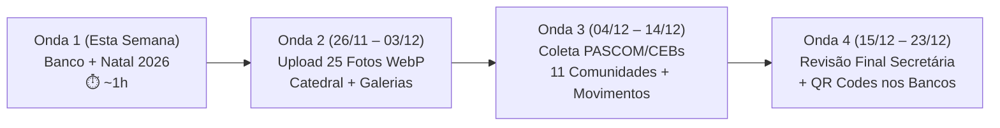

# 🏛️ Plano Mestre de Povoação Fotográfica, Editorial e de Dados
## Portal Oficial da Catedral do Sagrado Coração de Jesus — Solenidade do Natal 2026

> **Documento Oficial de Governança de Conteúdo & Mídia (SSOT)**  
> **Data:** 23 de Novembro de 2026  
> **Horizonte:** Solenidade do Natal 2026 (25/12/2026 — 32 dias de execução)  
> **Acervo Analisado:** 85 fotografias autorais de **Cláudio Costa** (`@claudiocostaimagens`) distribuídas em 2 álbuns compartilhados do Google Fotos  
> **Alinhamento:** [`PLANO_DESENVOLVIMENTO_NATAL_2026.md`](file:///c:/Users/Start/ecclesiam-app/%5Bdocumentation%5D/planejamento/PLANO_DESENVOLVIMENTO_NATAL_2026.md) e [`IMPLEMENTACOES_PENDENTES.md`](file:///c:/Users/Start/ecclesiam-app/%5Bdocumentation%5D/planejamento/IMPLEMENTACOES_PENDENTES.md)

---

## 🎯 1. Diagnóstico do Acervo Analisado (85 Fotografias)

A curadoria visual completa dos dois álbuns revelou um **acervo arquitetônico e devocional de altíssimo nível artístico** da Catedral Diocesana:

| Álbum | Link | Qtde | Período | Orientação | Foco Visual Principal |
| :--- | :--- | :-: | :--- | :--- | :--- |
| **Álbum 1** | [photos.app.goo.gl/A9uvRJpTBsAav7qX8](https://photos.app.goo.gl/A9uvRJpTBsAav7qX8) | **72 fotos** | Jun/2023 – Jul/2025 | 26 Paisagem (4 RAW) 46 Retrato (1 RAW) | Interior da Nave, Coro elevado, Presbitério, Vitrais (Sagrado Coração & Via Sacra), Batistério, Lamparina do Santíssimo, Presépio de Natal e Quaresma. |
| **Álbum 2** | [photos.app.goo.gl/ZPUn34GuJdYHA5R3A](https://photos.app.goo.gl/ZPUn34GuJdYHA5R3A) | **13 fotos** | Jul/2022 – Nov/2023 | 3 Paisagem 10 Retrato | Fachadas externas diurnas, noturnas iluminadas e panorâmicas elevadas da Catedral no centro de Colatina. |

> [!IMPORTANT]
> **Governança Autoral & Qualidade Mobile-First (Regras Inegociáveis):**
> 1. **Autorização & Crédito Autoral:** Confirmar formalmente com o fotógrafo **Cláudio Costa (`@claudiocostaimagens`)** a autorização de uso institucional no portal da Catedral e exibir o crédito *"Foto: Cláudio Costa"* no rodapé das galerias e na página de História.
> 2. **Seleção Limpa (Sem Marca d'Água em Heroes):** Priorizar sempre as versões **sem marca d'água** (ex.: toda a série HD de `15/07/2025`, `07/01/2025` e as `13` fotos do Álbum 2) para banners e capas. Ignorar duplicatas `.RAW` não tratadas.
> 3. **Hiper-Desempenho Mobile (Low-End Devices):** Converter 100% das fotos selecionadas para **`.webp`** com dimensões otimizadas:
>    * **Hero / Banners 16:9:** `1600x900` (`<= 120 KB`)
>    * **Cards 16:9 / Galerias:** `1200x675` (`<= 85 KB`)
>    * **Retratos / Cards 4:5:** `600x750` (`<= 55 KB`)

---

## 🗺️ 2. Mapa Cirúrgico de Povoação Fotográfica (Foto ➔ Rota do Portal)

### 🏠 A. Portal Inicial — Home (`/`)
| Posição na Tela | Foto Selecionada (Álbum & Data) | Proporção | Nome do Arquivo Alvo (`public/images/...`) |
| :--- | :--- | :-: | :--- |
| **Hero Principal (Fallback / Poster do Vídeo)** | **Álbum 1 (`15/07/2025`)** — Nave vista do coro/mezanino simétrica em HD *(ou **Álbum 2 #10 `04/05/2023`** panorâmica céu azul)* | 16:9 | `public/images/home/catedral-hero-coro.webp` |
| **Card da Comunidade Sede (Catedral)** | **Álbum 2 (`04/05/2023`, #10)** — Vista panorâmica elevada da Catedral com céu azul vibrante | 16:9 | `public/images/comunidades/catedral-sede-fachada.webp` |
| **Banner Especial de Natal 2026** | **Álbum 2 (`26/11/2023`, #12)** — Fachada noturna iluminada *(ou composição com Presépio `14/12/2023`)* | 16:9 | `public/images/festas/natal-catedral-2026.webp` |
| **Destaque Dízimo / Acolhida Pastoral** | **Álbum 1 (`09/11/2024`)** — Criança diante da porta luminosa do Sagrado Coração de Jesus | 4:5 | `public/images/dizimo/acolhida-sagrado-coracao.webp` |

---

### ⛪ B. Memória, História & Patrimônio Sacro (`/historia` + tabela `parish_sacred_heritage`)
Este é o módulo que mais se beneficia do acervo de Cláudio Costa — todas as peças de patrimônio sacro ganham fotografias reais de museu:

| Item de Patrimônio / Seção | Foto Selecionada (Álbum & Data) | Proporção | Destino no Sistema |
| :--- | :--- | :-: | :--- |
| **Hero da Página História** | **Álbum 1 (`07/01/2025`)** — Nave central simétrica olhando para o Presbitério e a Grande Cruz (versão editada) | 16:9 | `public/images/historia/nave-central-simetrica.webp` |
| **Patrimônio 1: Grande Vitral Frontal** | **Álbum 1 (`16/07/2024` / `04/06/2025`)** — Vitral em arco com inscrições *Sta. Margarida Maria*, *Sagrado Coração de Jesus* e *S. Cláudio de La Colombière* | 16:9 | `parish_sacred_heritage` + `public/images/historia/vitral-frontal-arco.webp` |
| **Patrimônio 2: Vitrais da Via Sacra** | **Álbum 1 (`27/07/2023` e `26/06–06/10/2023`)** — Close vibrante 16:9 do Sagrado Coração e cenas da Via Sacra | 16:9 | `parish_sacred_heritage` + `public/images/historia/vitral-sagrado-coracao.webp` |
| **Patrimônio 3: Arquitetura & Torres** | **Álbum 2 (`28/11/2023`, #13)** — Fachada frontal diurna limpa da avenida *(com leve corte nos cones da base)* | 4:5 | `parish_sacred_heritage` + `public/images/historia/fachada-frontal-limpa.webp` |
| **Patrimônio 4: Batistério & Pia Batismal** | **Álbum 1 (`15/07/2025`, 16:57:24)** — Pia batismal em mármore, Círio Pascal, piso em ondas azuis e painel do Batismo de Jesus | 16:9 | `parish_sacred_heritage` + `public/images/historia/batisterio-catedral.webp` |
| **Patrimônio 5: Nave & Reflexos Polidos** | **Álbum 1 (`20/01/2025`, 10:25:36)** — Grande angular diagonal limpa com espelhamento dos vitrais no piso | 16:9 | `parish_sacred_heritage` + `public/images/historia/nave-reflexos-vitrais.webp` |
| **Patrimônio 6: Imagens Devocionais** | **Álbum 1 (`23/01/2025` e `08/10/2023`)** — Sagrado Coração de Jesus e Nossa Senhora emoldurados pelos vitrais | 4:5 | `parish_sacred_heritage` + `public/images/historia/imagens-devocionais.webp` |

---

### 📜 C. Secretaria On-line, Sacramentos & Agenda Litúrgica (`/secretaria/*` e `/agenda-liturgica`)
| Submódulo | Foto Selecionada | Aplicação Prática |
| :--- | :--- | :--- |
| **Sacramento do Batismo** (`/secretaria/sacramentos`) | **Álbum 1 (`15/07/2025`)** — 2 fotos horizontais do **Batistério / Pia Batismal** | Card principal e cabeçalho do guia de preparação para o Batismo. |
| **Adoração ao Santíssimo & Confissões** (`/agenda-liturgica`) | **Álbum 1 (`30/04/2025`)** — **Lamparina vermelha do Santíssimo** com vitral ao fundo | Ilustração solene do bloco de Adoração ao Santíssimo e silêncio orante. |
| **Intenções da Santa Missa (Púlpito A4)** (`/secretaria/intencoes`) | **Álbum 1 (`15/07/2025`)** — Nave elevada olhando para o Presbitério | Imagem de acolhimento espiritual na tela de intenções. |
| **Banco de Mídia Litúrgica Sazonal (2026–2027)** | **Natal:** Presépio (`14/12/2023`) + Fachada iluminada (`26/11/2023`, #12) **Quaresma/Semana Santa:** Cruz velada em roxo e círio quaresmal (`07/03–17/04/2025`) | Ativos já catalogados em `public/images/liturgia/` para alternância automática ao longo do Ano Litúrgico! |

---

### 🖼️ D. Galerias Fotográficas Oficiais (`/comunidades/catedral-matriz` + tabela `galleries` / Storage `galleries`)
A tabela `galleries` hoje possui apenas **1 álbum**. Com o acervo curado, criaremos **3 álbuns oficiais da Catedral** (total de ~24 fotos selecionadas, sem duplicatas RAW):
1. **Álbum "Arquitetura e Fachadas da Catedral Diocesana"** *(8 fotos do Álbum 2: #4, #6, #7, #10, #11, #12, #13)* — Crédito: *Cláudio Costa*.
2. **Álbum "Os Vitrais do Sagrado Coração e Via Sacra"** *(8 fotos limpas do Álbum 1: vitral frontal em arco, detalhes dos anjos/Espírito Santo, Via Sacra e closes do Sagrado Coração)* — Crédito: *Cláudio Costa*.
3. **Álbum "Interior, Presbitério, Batistério e Reflexos"** *(8 fotos HD de 07/01/2025, 20/01/2025 e 15/07/2025 + Presépio 14/12/2023)* — Crédito: *Cláudio Costa*.

---

## 🗄️ 3. Povoação de Dados no Banco Vivo Supabase (Raio-X & Gaps Reais)

Cruzando o inventário fotográfico com a auditoria ao vivo executada em `23/11/2026` no projeto Supabase `ecclesiamapp` (`rlcaapydcozsshafyvxx`), este é o estado real de povoação do portal:

| Frente de Povoação | Estado Atual no Banco / Repo | Ação Necessária | Responsável |
| :--- | :--- | :--- | :---: |
| **Fotos da Catedral (Sede), Vitrais, Batistério e Natal** | 🟢 **85 fotos recebidas hoje!** | Baixar as ~25 melhores, converter para `.webp` otimizado e subir no Storage / `public/images/`. | **Start Agência** |
| **Clero Atual (4 Padres) & Bispos Diocesanos (4)** | 🟢 **100% povoado** (`clergy: 4`, `succession: 11`, retratos 4:5 em `.webp` prontos) | Apenas validar bio/telefone final com Pe. Irineu. | **Start Agência** |
| **Horários de Missas (`mass_schedules`)** | 🔴 **`0` registros no banco vivo!** *(rodando só pelo fallback `lib/schedules.ts`)* | Executar seed SQL de `lib/schedules.ts` ➔ `public.mass_schedules` e validar horários reais com a secretária. | **Start Agência + Secretária** |
| **Programação Especial de Natal 2026 (`parish_special_events`)** | 🟡 Apenas evento antigo da Co-Padroeira (encerrado em 22/11) | Cadastrar **Solenidade do Natal 2026** (Novena, Missa do Galo 24/12, Natal 25/12 e Ano Novo) usando a foto noturna `#12` e o Presépio. | **Start Agência + Secretária** |
| **Mensagens Pastorais de Natal (`pastoral_messages`)** | 🟢 **`4` registros ativos** (cartas do Bispo e Pároco) | Confirmar texto final das Cartas de Natal 2026 com Dom Lauro / Pe. Irineu. | **Pe. Irineu** |
| **Fotos das 11 Comunidades (CEBs) + Santa Rita** | 🔴 **Ausentes nos 2 álbuns enviados** *(álbuns são 100% da Catedral Sede)* | Coletar 1 foto de fachada (16:9) + 1 interna de cada CEB via grupo de WhatsApp dos coordenadores / PASCOM. | **PASCOM + Coordenadores CEBs** |
| **Fotos dos Movimentos (ECC, EAC, EJC) & Catequese** | 🔴 **Ausentes nos 2 álbuns enviados** *(apenas 1 foto da criança na porta)* | Coletar 3 fotos reais por movimento com os casais/jovens coordenadores (com termo de uso de imagem / ECA Digital para menores). | **Coordenação ECC / EAC / EJC** |
| **Dados Operacionais Definitivos da Secretaria** | 🟡 Valores provisórios/fallback em alguns campos | Confirmar oficialmente: **Chave PIX definitiva da Mitra/Catedral**, **WhatsApp oficial da Secretaria**, **Horários de Confissão dos 4 padres** e **credenciais DNS (`TASK-12`)**. | **Secretária + Pe. Irineu** |

---

## 🗓️ 4. Cronograma de Execução da Povoação em 4 Ondas (Rumo ao Natal 25/12)

### 🌊 Onda 1 — Povoação Estrutural Imediata *(Depende só da Start Agência — ⏱️ ~45 a 60 min)*
1. **Popular `public.mass_schedules` no Supabase** com todos os horários canônicos de [`lib/schedules.ts`](file:///c:/Users/Start/ecclesiam-app/lib/schedules.ts) (tirar do zero para que `/admin/horarios` funcione 100% no banco real).
2. **Cadastrar a Solenidade do Natal 2026** em `public.parish_special_events` + `parish_event_days` (Novena, Vigília/Missa do Galo 24/12, Natal 25/12 e Ano Novo), ativando o banner de contagem regressiva na Home.
3. **Atualizar [`lib/events.ts`](file:///c:/Users/Start/ecclesiam-app/lib/events.ts)** para refletir o Natal 2026 também no fallback.

### 🌊 Onda 2 — Ingestão das ~25 Melhores Fotos de Cláudio Costa *(⏱️ ~45 a 60 min)*
1. Confirmar autorização de crédito com **Cláudio Costa** (`Foto: Cláudio Costa`).
2. Baixar dos 2 álbuns as **~25 fotos selecionadas** (priorizando `15/07/2025`, `07/01/2025`, `20/01/2025`, `14/12/2023`, `09/11/2024`, `30/04/2025` e Álbum 2 `#10`, `#12`, `#13`).
3. Converter em lote para `.webp` (16:9 `<= 120KB` e 4:5 `<= 55KB`) e aplicar em:
   * Home Hero & Card da Catedral Sede
   * Página `/historia` & 6 itens de `parish_sacred_heritage`
   * Batistério em `/secretaria/sacramentos` e Lamparina em `/agenda-liturgica`
   * 3 Álbuns oficiais na tabela `public.galleries` (Storage `galleries`).

### 🌊 Onda 3 — Coleta Dirigida com a Paróquia (Mensagem Pronta para Enviar no WhatsApp)
Enviar um único checklist objetivo para **Pe. Irineu / Secretária / PASCOM** pedindo apenas o que falta:
* [ ] **1 foto horizontal da fachada** de cada uma das 11 Comunidades (CEBs) + Grupo Santa Rita (Brisa do Vale).
* [ ] **3 fotos** de encontros do ECC, EAC e EJC (sem exposição indevida de menores).
* [ ] **Confirmação oficial dos dados de balcão:** Chave PIX da Catedral, número de WhatsApp oficial da secretaria, horários confirmados da Novena e Missa do Galo (24/12) e horários de atendimento dos 4 padres.
* [ ] **Liberação do acesso DNS** (`catedraldecolatina.org.br`) para apontamento com Cloudflare Free (`TASK-12`).

### 🌊 Onda 4 — Validação Final & Campanha PWA nos Bancos (15/12 a 23/12)
* Conferir todas as 12 CEBs, horários e intenções com a secretária no `/admin`.
* Imprimir o lote de displays e cartões de bolso em [`/instalar/imprimir`](http://localhost:3000/instalar/imprimir) para posicionar nos bancos antes da Missa da Vigília (24/12).

---

> 📌 **Resultado Esperado:** Com o acervo de 85 fotos de Cláudio Costa + as 4 ondas acima, o portal da Catedral de Colatina chega ao Natal com **fotografia de padrão de catedral europeia**, banco 100% real (zero tabelas essenciais vazias) e carregamento instantâneo no celular dos fiéis.
