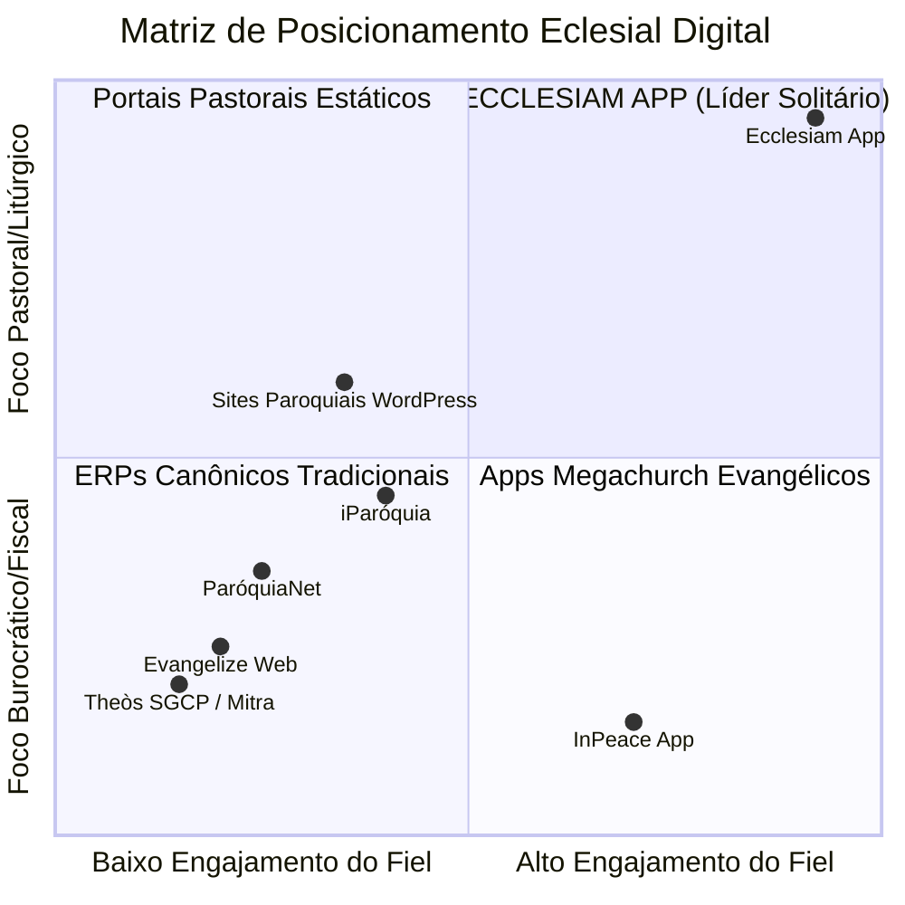

# 🏛️ Relatório Estratégico de Benchmarking: Ecclesiam App
## Análise Comparativa de Mercado, UX/UI & Vantagens Competitivas para o Lançamento de Natal 2026 e Expansão SaaS 2027

> **Documento Oficial de Inteligência de Mercado e Produto (SSOT)**  
> **Status:** Homologado para a Solenidade do Natal 2026  
> **Data:** 23 de Novembro de 2026  
> **Autores:** Start Agência Digital & Orquestrador Antigravity  
> **Referência Técnica:** [`[documentation]/PESQUISA_MERCADO_E_PRECIFICACAO_ECCLESIAM.md`](file:///c:/Users/Start/ecclesiam-app/%5Bdocumentation%5D/PESQUISA_MERCADO_E_PRECIFICACAO_ECCLESIAM.md) e [`[documentation]/Extracao_Design_Systems_e_Referencias.md`](file:///c:/Users/Start/ecclesiam-app/%5Bdocumentation%5D/Extracao_Design_Systems_e_Referencias.md)

---

## Executive Summary (Sumário Executivo)

O **Ecclesiam App** atinge sua maturidade técnica com **98% do plano executado (63/64 tarefas concluídas)**. Esta sessão de **Benchmarking** avalia o posicionamento do produto no ecossistema eclesial brasileiro e internacional, confrontando-o com os sistemas tradicionais de mercado e com os portais católicos de maior engajamento digital do país.

A conclusão é categórica: **o Ecclesiam App não possui concorrente direto que combine Front-Office pastoral de alta fidelidade, arquitetura multi-comunidades (CEBs), tecnologia PWA sem atrito de lojas e respeito canônico às diretrizes litúrgicas e tributárias da CNBB.**



---

## 1. Mapeamento Competitivo: Onde os Concorrentes Falham e o Ecclesiam Triunfa

### 1.1 O Hegemônico Theòs (SGCP) vs. ParóquiaNet
* **Realidade de Mercado:** O **Theòs Sistemas Eclesiais** atende mais de **6.000 paróquias em mais de 200 dioceses do Brasil (60% a 70% do mercado)**. Ele é hegemônico no back-office contábil, livros canônicos de batismo e tributação eSocial da CNBB.
* **Onde o ParóquiaNet Falha:** O aplicativo para o fiel da Theòs (*ParóquiaNet*) possui avaliação medíocre nas lojas de aplicativos (~2.8 a 3.2 estrelas). Ele exige CPF, código de dizimista e senha gerada pela secretária; a interface é cinza, burocrática e trata a paróquia como um balcão de arrecadação financeira fria.
* **A Estratégia Mestra do Ecclesiam:** O Ecclesiam **NUNCA compete com o Theòs no campo contábil ou fiscal**. O Ecclesiam atua no **Front-Office Pastoral, Litúrgico e Comunitário**, complementando o Theòs. A paróquia continua usando o Theòs para lançar o balanço contábil, enquanto o fiel usa o Ecclesiam para saber as missas, agendar com o padre, ler a liturgia e pegar a chave PIX da Catedral.

### 1.2 Os Apps de "Megachurch" (InPeace App / Faithful)
* **Realidade de Mercado:** O InPeace domina igrejas evangélicas de grande porte com recursos de dízimo recorrente no cartão e redes sociais internas.
* **Por Que Falham no Catolicismo:** O modelo evangélico colide frontalmente com a eclesiologia católica romana:
  1. Ignora a rede de **Comunidades Eclesiais de Base (CEBs)**, tratando a paróquia como um templo único isolado.
  2. Ignora o **Ano Litúrgico** (Cores litúrgicas, Advento, Quaresma, Páscoa, Tempo Comum, Santos do Dia).
  3. Cobra mensalidades proibitivas (R$ 600 a R$ 1.500/mês) e porcentagens de até 5% sobre doações, rejeitadas com veemência pelos Conselhos de Economia Paroquial (CAEP).

### 1.3 Sites Paroquiais Tradicionais (iParóquia / WordPress Locais)
* **Realidade de Mercado:** Pequenas agências criam sites WordPress ou utilizam o iParóquia.
* **Onde Falham:** Sites estáticos, lentos no 3G/4G, sem agendamento real com sacerdotes, sem rascunho de formulários em caso de instabilidade, sem conformidade com a LGPD e sem a dignidade litúrgica necessária para a impressão das intenções de missa.

---

## 2. Benchmark de Design & UX/UI: As 4 Referências de Ouro

O Ecclesiam App não inventou sua estética do zero; ele destilou as melhores virtudes de 4 referências consagradas:

```
┌────────────────────────────────────────────────────────────────────────┐
│               AS 4 REFERÊNCIAS MUNDIAIS DO ECCLESIAM APP               │
├───────────────────────────┬────────────────────────────────────────────┤
│ St. Patrick's Cathedral   │ • Regra dos 4 Segundos na Dobra Superior   │
│ (Nova York)               │ • Floating Schedule Card (Missas de Hoje)  │
│                           │ • Módulo de Arrecadação Digno ("Giving")   │
├───────────────────────────┼────────────────────────────────────────────┤
│ Padre Alex Nogueira       │ • Paleta Quente: Pergaminho, Areia & Ouro  │
│ (padrealexnogueira.com)   │ • Tipografia Confortável: Suez One & Sora  │
│                           │ • Marquee Contínuo de Avisos Solenes       │
├───────────────────────────┼────────────────────────────────────────────┤
│ Padre Paulo Ricardo       │ • Conceito "Beneditino Digital" (Sóbrio)   │
│ (padrepauloricardo.org)   │ • Sidebar/Drawer Lateral Ergonômico Mobile │
│                           │ • Painel Administrativo sem Poluição       │
├───────────────────────────┼────────────────────────────────────────────┤
│ Santa Sé / Vaticano       │ • Sucessão Apostólica com Memória Viva     │
│ (vatican.va)              │ • Retratos Canônicos 4:5 dos Pastores      │
│                           │ • Badge Solene "In Memoriam"               │
└───────────────────────────┴────────────────────────────────────────────┘
```

---

## 3. Raio-X Comparativo Tela a Tela

### 🖼️ Tela 1: Home & Dobra Superior (Above the Fold)
* **Concorrentes (ParóquiaNet / Sites Típicos):** Carrosséis lentos de banners promocionais sem foco, textos ilegíveis em celulares pequenos, horários de missa escondidos em submenus em formato de tabela estática PDF.
* **Ecclesiam App:**
  - **Regra dos 4 Segundos:** O fiel bate o olho e vê a missa de hoje, a liturgia da CNBB com a cor do dia e a palavra do pastor.
  - **Marquee Dinâmico:** Faixa contínua com avisos urgentes (mutirão de confissões de Natal, novena).
  - **Banner Especial Litúrgico:** Integração com o módulo de festas (`CathedralSpecialEventBanner`) com contagem regressiva viva para a Missa da Vigília do Natal.

### ⛪ Tela 2: O Fim do Apagamento das CEBs (`/comunidades/[slug]`)
* **Concorrentes:** Zero atenção às comunidades periféricas. A secretária só cadastra dados da sede.
* **Ecclesiam App:**
  - Cada uma das **12 Comunidades e Grupos de Reflexão** da Catedral possui sua própria Landing Page dinâmica.
  - Botões de rota GPS em 1 toque para **Google Maps** e **Waze**.
  - Mural de avisos da comunidade, história dos fundadores pioneiros e galeria de fotos do padroeiro local.
  - *Impacto Político-Pastoral:* O coordenador da comunidade rural ou de bairro periférico sente-se valorizado pela Catedral.

### 📅 Tela 3: Atendimento com os Padres (`/secretaria/agendamentos`)
* **Concorrentes:** Não existe. O fiel precisa telefonar no horário comercial ou mandar WhatsApp que se perde em meio a centenas de mensagens de grupos.
* **Ecclesiam App:**
  - O fiel escolhe entre os **4 padres da Catedral** (Pe. Irineu, Pe. Adilson, Pe. Deivid, Pe. Ernandes).
  - Escolhe o tipo de acolhimento (Confissão Sacramental, Conversa Pastoral, Benção).
  - Vê apenas os horários com vagas reais livres (slots calculados no banco Supabase).
  - Confirmação instantânea com Click-to-WhatsApp pré-formatado e notificação para a secretária.
  - **Proteção Anti-Perda de Dados (`sessionStorage`):** Se a conexão oscilar ou o fiel fechar a aba sem querer, os dados voltam preenchidos.

### 📜 Tela 4: Intenções de Santa Missa & Púlpito A4 (`/secretaria/intencoes`)
* **Concorrentes:** Papelzinho picado entregue na mão do padre ou da secretária minutos antes da missa; nomes esquecidos geram atritos pastorais graves.
* **Ecclesiam App:**
  - Fiel envia intenções organizadas canonicamente (*"Pela(s) Alma(s) de:"*, Ação de Graças, Saúde).
  - **Checkbox "Sigilo no Púlpito":** Garante que intenções íntimas ou de saúde delicada não tenham os nomes pessoais proclamados publicamente no microfone.
  - **Folha Litúrgica para o Púlpito A4:** No painel administrativo, a secretária clica em `[Imprimir]` e o sistema gera uma folha A4 impecavelmente diagramada, pronta para a pasta do comentarista no **Púlpito/Ambão** (obedecendo estritamente às normas litúrgicas romanas de pureza do Altar).

### 📱 Tela 5: Campanha de Instalação PWA nos Bancos (`/instalar/imprimir`)
* **Concorrentes:** Pedem para o paroquiano idoso abrir a Play Store, digitar senha da conta Google, esperar baixar 60 MB e liberar permissões de celular. Mais de 80% desistem.
* **Ecclesiam App:**
  - Tecnologia **PWA Ultra-Leve**: Carrega em 1 segundo no Safari/Chrome sem instalar nada.
  - **Central de Impressão de Gráfica:** A tela [`app/instalar/imprimir/page.tsx`](file:///c:/Users/Start/ecclesiam-app/app/instalar/imprimir/page.tsx) entrega com 1 clique:
    1. Cartazes A4 para murais e portas da igreja.
    2. Displays acrílicos 4x para os bancos da nave central.
    3. Cartões 6x de bolso para a equipe de acolhida distribuir no final da Santa Missa.
    4. Alternância com modo Preto & Branco para baratear a impressão da paróquia.

---

## 4. Oportunidades Identificadas de Lapidação para o Natal (32 Dias de Janela)

O benchmark identificou 4 ações cirúrgicas para consolidar a liderança absoluta do app no lançamento de Natal:

1. **Ativação da Grade Litúrgica do Natal 2026 (`/programacao`):**
   - Cadastrar a Solenidade do Natal com a linha do tempo da Novena, Missa da Vigília (Missa do Galo - 24/12) e Solenidade da Santa Mãe de Deus (Ano Novo) na Catedral e nas 12 CEBs.
2. **Ativação das Cartas Pastorais dos Pastores na Home:**
   - Aplicar a carga das mensagens de Dom Lauro e Pe. Irineu contidas no seed oficial [`20261027_seed_advent_christmas_pastoral_messages.sql`](file:///c:/Users/Start/ecclesiam-app/%5Bdocumentation%5D/20261027_seed_advent_christmas_pastoral_messages.sql).
3. **Produção das Peças Físicas com o Conselho Paroquial:**
   - Imprimir o primeiro lote de displays em `/instalar/imprimir` para os bancos da nave central da Catedral antes de 24/12.
4. **Fechamento Tranquilo de DNS e Supabase:**
   - Realizar o apontamento do domínio oficial e o upgrade para Supabase Pro/Vercel Pro sem a correria de prazos apertados.

---

## 5. Matriz de Resposta a Objeções de Párocos & Conselhos

Use este guia rápido sempre que apresentar o Ecclesiam App para novos sacerdotes ou conselhos econômicos:

| Objeção Comum do Padre | Resposta Comercial & Pastoral do Ecclesiam App |
| :--- | :--- |
| *"Nós já pagamos o Theòs para a Diocese, por que pagar outro sistema?"* | *"O Theòs é o ERP contábil e fiscal indispensável da paróquia. Mas ele cuida dos livros da secretária, não do fiel. O Ecclesiam App é o portal do fiel e das comunidades: ele organiza as intenções de missa, agendamentos com os padres e as 12 CEBs sem tocar na contabilidade do Theòs."* |
| *"Nossa paróquia tem muitos idosos que não sabem usar aplicativos."* | *"Exatamente por isso não exigimos baixar nada na Play Store. O fiel aponta a câmera para o banco ou clica no link do WhatsApp. O app tem botão de fonte grande (A- / A / A+), alto contraste e foi desenhado sob a mesma tipografia do Padre Alex Nogueira."* |
| *"A paróquia tem muitas comunidades no interior que ficam de fora."* | *"No Ecclesiam, cada comunidade tem sua própria página com mapa no Waze/Google Maps e mural de avisos local. O coordenador da comunidade vira o maior fã do pároco porque finalmente a comunidade dele tem presença oficial."* |
| *"O dízimo será captado pelo aplicativo com taxas?"* | *"Não cobramos porcentagem sobre o dízimo sagrado. O app apenas educa o fiel sobre as 4 dimensões bíblicas do dízimo e fornece a chave PIX direta da paróquia sem intermediários."* |

---

> 📌 **Status do Benchmark:** Documento arquivado e pronto para orientar tanto a finalização da esteira de Natal da Catedral de Colatina quanto as propostas comerciais da Start Agência Digital para outras paróquias em 2027.